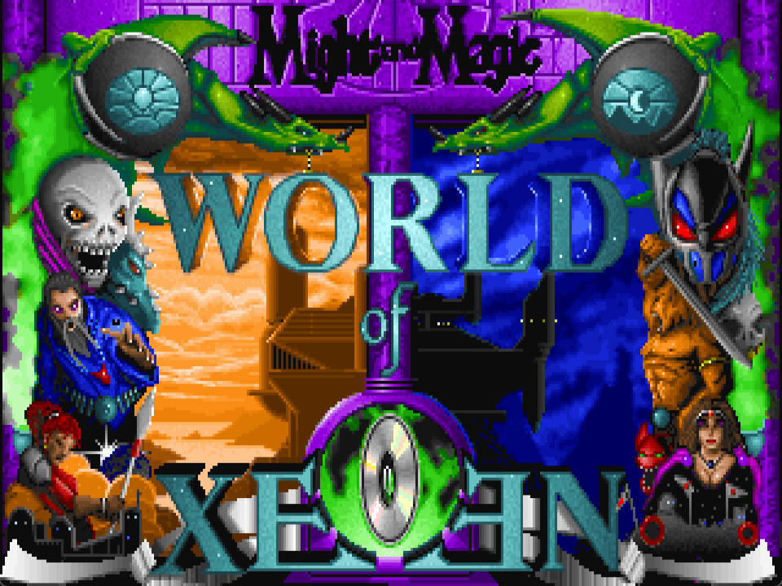

# MMModern

> [!IMPORTANT]
> MMModern is an unofficial fan project and is still incomplete. It ships no
> game data: you need your own English World of Xeen CD edition, sold by GOG as
> "Might and Magic 4-5".

MMModern is an open-source reimplementation of the engine behind
Might and Magic IV: Clouds of Xeen and Might and Magic V: Darkside of Xeen /
World of Xeen. It runs on your own copy of the game data and aims to look,
play and behave like the original DOS game. Anything the original never had,
such as game controller support or picture filters, is an option that is off by default.

MMModern is not a port of ScummVM's Xeen engine. It reuses some ScummVM code,
but where ScummVM and DOS behave differently it follows DOS. The
[ScummVM differences][differences] page lists the known cases.

## What works today

Clouds of Xeen and Darkside of Xeen can both be played from a new game to
their endings, and winning World of Xeen plays its own ending too. Clouds has
been checked from the start through Lord Xeen to the ending. Darkside hasn't
been played through in one go yet, so expect more bugs there than in Clouds.
[Reports](#reporting-a-problem) are very welcome.

What you get today:

- Windows, Linux and Steam Deck versions.
- Keyboard and mouse as in the original, or a
  [game controller](#game-controller).
- The original music, sound effects and CD speech, including MT-32 music if
  you have the ROMs.
- English, or Russian with the old-games.ru fan translation
  ([how to set it up][guide-russian]).

## Download and play

You need a legally obtained English World of Xeen CD edition, installed or
copied to a folder. MMModern never copies or modifies your game files.

### Windows

You need Windows 10 or 11, 64-bit.

1. Download the latest `MMModern-<version>-windows-x64.zip` from the
   [releases page][releases].
2. Unpack it into a folder of its own, not inside the game folder.
3. Double-click `MMModern.bat` to open the launcher. It finds a GOG
   installation by itself. If it doesn't find yours, click **Change game
   folder** and choose the folder that contains `WORLD\XEEN.DAT`.
4. Press Enter or click **Play**.

If the game fails to start, the launcher shows the error and offers to open
its log.

### Linux

You need 64-bit x86 Linux.

1. Download `MMModern-<version>-x86_64.AppImage` from the
   [releases page][releases].
2. Make it executable in your file manager's Properties, or with
   `chmod +x MMModern-<version>-x86_64.AppImage`.
3. Run it. The setup screen looks for GOG installations in `~/Games/Heroic`,
   `~/GOG Games` and the default Wine prefix. If it doesn't find yours, use
   **Change game folder** and choose the folder that contains
   `WORLD/XEEN.DAT`.
4. Press Enter or click **Play**.

### Steam Deck

The Linux AppImage runs on the Deck in Desktop Mode or, added to Steam as a
non-Steam game, in Game Mode. The Windows package also runs through Proton.
The [player guide][guide-deck] has the steps for both and the control
layouts.

## Controls

The mouse works on every button, portrait and dialog, as in the original. The
most used keys:

| Key | Action |
| --- | --- |
| Arrow keys | Move and turn |
| Ctrl+Left / Ctrl+Right | Strafe |
| Space | Interact; continue text |
| F1-F6 | Character sheet; pick a party member |
| A / B / R | Attack / Block / Run in combat |
| S / R / B | Shoot / Rest / Bash while exploring |
| C | Cast a spell |
| M / = | Map / automap on or off |
| Tab | Control panel: Save, Load, Quit |
| Escape | Back or cancel |
| Alt+Enter | Window or fullscreen |
| F11 | Next picture filter (off by default) |

The [full list of controls][controls] covers the character sheet, Items,
Quick Fight and every service.

### Game controller

A game controller can play the whole game, menus, shops and typing names
included. The original has no controller support, so the option is off until
you turn it on:

- Windows: tick **Play with a game controller** in the launcher.
- Linux, and the AppImage on a Steam Deck: turn on the **Game controller**
  row of the setup screen.
- Windows package on a Steam Deck (Proton): set `controller=on` in
  `window.ini`, as the [player guide][guide-deck] shows.

The D-pad or left stick walks and turns, A interacts and B cancels. The right
stick moves the pointer and RT clicks, which reaches everything that has no
button of its own. The [controller layout][controller] lists every button.

### Picture filters

The picture can be softened with one of ScummVM's classic pixel-art filters
(AdvMame, HQ, Edge, SaI and others). The original has none, so it is off until
you choose one: the **Picture filter** list in the Windows launcher, the
setup screen row on Linux, or `filter=` in `window.ini`. F11 switches to the
next filter while you play. The [player guide][guide-filters] lists them.

## More for players

The [player guide][guide] covers what this page leaves out:

- [Steam Deck][guide-deck] setup, through the AppImage or Proton.
- The [Russian translation][guide-russian]: which files you need and how to
  select them.
- [Display][guide-display]: fullscreen, 4:3 or square pixels, and picture
  filters.
- [Sound][guide-sound]: choosing the original sound devices, and MT-32 ROMs.
- [Saves][guide-saves] and [where MMModern keeps its files][guide-files].

While MMModern is at 0.x, a new release may change the save format, and
saves from older releases then stop loading. Compatibility will be
reconsidered for 1.0.

## Reporting a problem

Use **Copy diagnostics** in the launcher or the setup screen and paste the
report into a [bug report][bug]. Describe what happened, what you expected
and the steps, with map and coordinates when you know them. Attach
`mmodern.log` from the `logs` folder of
[MMModern's user folder][guide-files], and the affected save slot from the
folder shown in the report. If the game crashed and you have started it
again since, the crashed run's log is `mmodern-previous.log`. Never attach
original game files or MT-32 ROMs.

## About the project

- [Project status][status]: what can be played, the architecture and the
  known gaps.
- [Roadmap][roadmap]: what comes next, including the optional extras under
  consideration.
- [Project history][history]: the finished milestones.
- [ScummVM differences][differences]: where MMModern behaves differently
  from ScummVM, and why.
- [Game rules reference][rules]: mechanics and formulas, with the evidence
  from the original program.

## Building

Development uses Windows x86-64 with MSYS2 UCRT64, or Linux x86-64 with GCC,
plus CMake, SDL2, zlib, libvorbis/libogg and a separate ScummVM source and
build tree. MMModern links selected ScummVM Xeen and support code, but it
does not run ScummVM's engine or its SDL backend.

- [Dependencies][dependencies]: the toolchain, the pinned ScummVM revision
  and release packaging.
- [Development][development]: command-line entry modes, the test suite and
  the developer test saves.
- [Agent instructions][agents]: development, documentation and Git rules.

## Disclaimer and license

MMModern is unofficial and is not affiliated with or endorsed by Ubisoft,
New World Computing or the ScummVM project. Might and Magic names and assets
belong to their respective copyright holders.

MMModern is distributed under the GNU General Public License version 3 or, at
your option, any later version (GPL-3.0-or-later). Reused ScummVM code is
copyright its respective contributors and licensed under GPLv3 or later. The
release zip's `THIRD-PARTY.txt` lists the bundled libraries, including static
libvorbisfile, libvorbis and libogg, their licenses and corresponding source.

[releases]: https://github.com/carbiecarbie/MMModern/releases
[bug]: https://github.com/carbiecarbie/MMModern/issues/new?template=bug_report.yml
[guide]: https://github.com/carbiecarbie/MMModern/blob/main/docs/player-guide.md
[guide-deck]: https://github.com/carbiecarbie/MMModern/blob/main/docs/player-guide.md#steam-deck
[guide-russian]: https://github.com/carbiecarbie/MMModern/blob/main/docs/player-guide.md#russian
[guide-display]: https://github.com/carbiecarbie/MMModern/blob/main/docs/player-guide.md#display
[guide-filters]: https://github.com/carbiecarbie/MMModern/blob/main/docs/player-guide.md#picture-filters
[guide-sound]: https://github.com/carbiecarbie/MMModern/blob/main/docs/player-guide.md#sound
[guide-saves]: https://github.com/carbiecarbie/MMModern/blob/main/docs/player-guide.md#saves
[guide-files]: https://github.com/carbiecarbie/MMModern/blob/main/docs/player-guide.md#where-mmmodern-keeps-its-files
[controls]: https://github.com/carbiecarbie/MMModern/blob/main/docs/controls.md
[controller]: https://github.com/carbiecarbie/MMModern/blob/main/docs/controls.md#game-controller
[status]: https://github.com/carbiecarbie/MMModern/blob/main/docs/project-status.md
[roadmap]: https://github.com/carbiecarbie/MMModern/blob/main/docs/roadmap.md
[history]: https://github.com/carbiecarbie/MMModern/blob/main/docs/project-history.md
[differences]: https://github.com/carbiecarbie/MMModern/blob/main/docs/scummvm-differences.md
[rules]: https://github.com/carbiecarbie/MMModern/blob/main/docs/rules/README.md
[dependencies]: https://github.com/carbiecarbie/MMModern/blob/main/docs/dependencies.md
[development]: https://github.com/carbiecarbie/MMModern/blob/main/docs/development.md
[agents]: https://github.com/carbiecarbie/MMModern/blob/main/AGENTS.md
